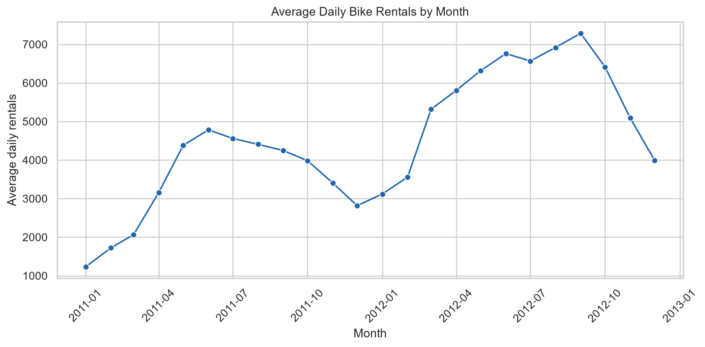
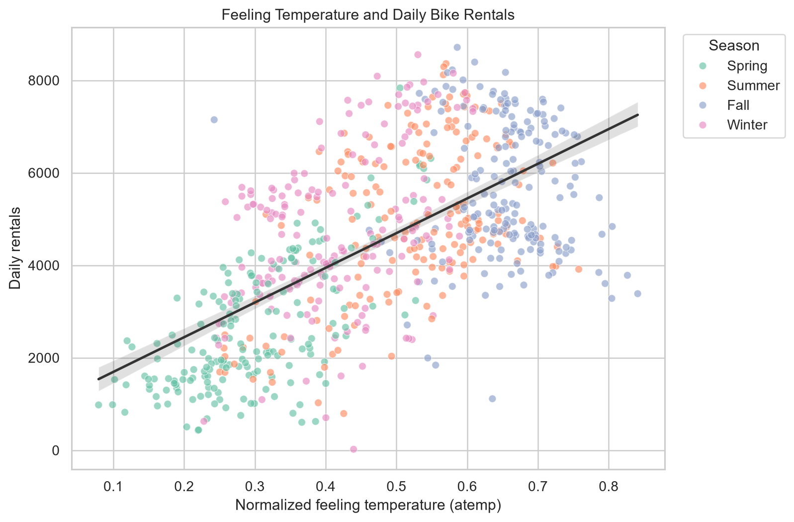

# Bike Sharing Demand Analysis

This project explores how season, weather conditions, and temperature relate to daily bike-sharing demand in Washington, D.C.

## Research question

How do season, weather conditions, and temperature relate to daily bike-sharing demand?

## Dataset and permissions

The analysis uses daily records from the [UCI Bike Sharing Dataset](https://archive.ics.uci.edu/dataset/275/bike+sharing+dataset), covering Capital Bikeshare in Washington, D.C. from 2011 through 2012. The analysis file is included at data/day.csv so the notebook can run without a separate download.

**Citation:** Fanaee-T, H. (2013). *Bike Sharing Dataset*. UCI Machine Learning Repository. https://doi.org/10.24432/C5W894

The dataset is available under the [Creative Commons Attribution 4.0 International (CC BY 4.0) license](https://creativecommons.org/licenses/by/4.0/). Retain the attribution when reusing it. If data/day.csv is removed, the notebook downloads the UCI archive and extracts the daily data.

## Methods and tools

- Python, pandas, NumPy, Matplotlib, and seaborn
- Checks for missing values, duplicate rows, and non-negative rental counts
- Monthly aggregation and comparison by weather condition
- Scatter plot and Pearson correlation for normalized feeling temperature and daily rentals

## Key findings

- The highest monthly average was **7,286 rentals per day in September 2012**; the lowest was **1,232 per day in January 2011**.
- Feeling temperature and daily rentals had a **Pearson correlation of 0.63**, indicating a positive association.
- Clear or partly cloudy days had the highest average rentals (**4,877 per day**); light rain or snow had the lowest (**1,803 per day**).

These results describe associations in this dataset and do not establish cause and effect.

## Visualizations

### Monthly average daily rentals



### Feeling temperature and daily rentals



## Project files

```text
.
├── data/
│   ├── day.csv
│   └── README.md
├── figures/
│   ├── monthly_rentals.png
│   └── temperature_vs_rentals.png
├── notebooks/
│   └── bike_sharing_analysis.ipynb
├── .gitignore
├── README.md
└── requirements.txt
```

## How to reproduce the analysis

1. Clone this repository and open a terminal in its root directory.
2. Create and activate a virtual environment.
3. Install the pinned dependencies:

   ```bash
   python -m pip install -r requirements.txt
   ```

4. Start Jupyter from the repository root and open the notebook:

   ```bash
   jupyter notebook notebooks/bike_sharing_analysis.ipynb
   ```

5. Run all cells from top to bottom. The notebook reads data/day.csv and saves figures into figures/.

On Windows PowerShell, create and activate the environment with:

```powershell
python -m venv .venv
.\.venv\Scripts\Activate.ps1
```

## Limitation

This is an observational analysis of one bike-sharing system over a two-year period. Temperature, season, weather, calendar effects, and other factors can vary together, so the observed relationships do not prove causation and may not generalize to other cities or time periods.

## Privacy and data safety

This repository contains no passwords, API keys, personal data, or restricted datasets.
